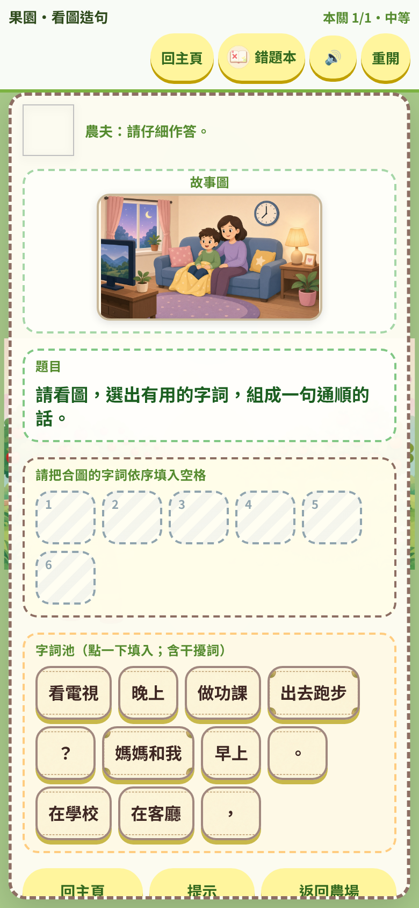
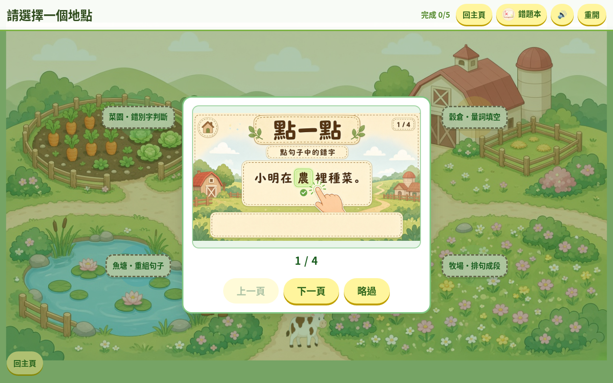
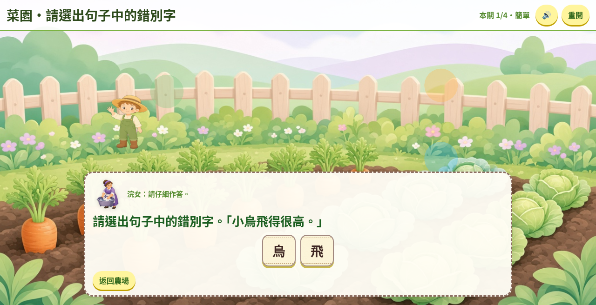

# 田園語遊

香港小學二年級中國語文練習遊戲（網頁版）。學生在農場地圖上選擇地點，以「點選」完成五類語文任務；答對／答錯即時回饋，完成關卡後返回總圖繼續探索。

**永久試玩連結：** [https://angusqaq.github.io/tianyuan-yuyou/](https://angusqaq.github.io/tianyuan-yuyou/)

無需安裝。電腦與手機瀏覽器皆可開啟（建議直式手機或平板）。

---

## 這是一款怎樣的程式

| 項目 | 說明 |
|------|------|
| 類型 | 網頁瀏覽器遊戲（HTML／CSS／JavaScript） |
| 對象 | 香港小二中文學習 |
| 文案 | 繁體中文（香港書面語） |
| 操作 | 觸控與滑鼠同一套「點選」 |
| 存檔 | 僅本機（例如錯題紀錄）；不上網帳號、不連線伺服器答題 |
| 聲音 | 背景音樂可循環；可調音量或靜音；無粵語語音朗讀 |

畫面風格為柔和扁平卡通農場（粉綠／奶油／淺藍），角色與答題塊為透明底剪影。

---

## 遊戲截圖







---

## 怎麼玩（跟著環節學）

不必先讀長篇說明。請依下列環節順序玩一輪：每完成一步，下一關的操作就會自然學會。

### 1. 進入主頁，開始遊戲

開啟上方永久連結 → 進入主頁 → 點「開始遊戲」（或同等入口）。可先略過開場教學分頁。

### 2. 選擇難度

簡單／中等／困難會改變題目份量與選項數量。可在總圖或主頁重選。

### 3. 在農場總圖選地點

總圖上有五個地點。點一個熱點，就進入該關：

| 地點 | 學什麼 | 你怎麼做 |
|------|--------|----------|
| 菜園 | 錯別字判斷 | 點句子裏的錯字 |
| 魚塘 | 重組句子 | 依序點字塊填入空格 |
| 牧場 | 排句成段 | 依序點句塊填入空格 |
| 穀倉 | 量詞填空 | 點正確選項 |
| 果園 | 看圖造句 | 點字詞與標點填入句槽，組成呼應圖意的完整句 |

完成的關會蓋上完成印章。手機直式畫面可上下捲動，確保五個地點都能點到。

### 4. 關內答題

- **看題幹**（菜園看句子；果園先看故事圖）。
- **點選作答**：點字、點選項，或點字塊／句塊入空格。
- **答對**：看到解釋，繼續下一題。
- **答錯**：彈出書面語解釋（說明錯在哪、應怎樣），可再試。沒有「關內回主頁」；走完本關或重開才回總圖。

### 5. 提示與錯題本

- **提示**：可多次使用；內容是本題具體線索，不是空泛鼓勵。
- **錯題本**：答錯會自動記下題目、解釋與正確答案，方便稍後重看（資料留在本機）。

### 6. 聲音

頂欄可開音量面板：靜音，或分別調背景音樂與按鈕音效。首次在手機上播放音樂，通常要先點一下畫面解鎖音訊。

### 7. 單一關卡結束

該關題目全部完成後，會出現完結畫面，然後自動返回農場總圖。該地點會蓋上完成印章，可再選其他地點。

### 8. 五關都完成

同一難度下，菜園、魚塘、牧場、穀倉、果園五個印章都齊了，會先出現全屏稱讚畫面（「五關完成！你是語文小能手！」），再點「回到主頁」返回總圖。

這樣一路玩下來，不用先背長篇說明，也能學會五種點選答題方式。

---

## 學習重點（對應關卡）

1. **錯別字**：在真實句子中找出形近或常見錯字，並看見正確寫法。  
2. **重組句子**：按語序把字排成通順的句子。  
3. **排句成段**：把句子排成一段，注意句末標點。  
4. **量詞**：為名詞選恰當量詞。  
5. **看圖造句**：根據圖意組成完整、有標點、前後一致的書面語句子。

---

## 本機開啟（開發用）

倉庫根目錄已含可直接託管的靜態檔（`index.html`、`js/`、`art/`、`audio/` 等）。用任何靜態伺服器開啟根目錄即可，例如：

```bash
npx --yes serve .
```

正式公開網址請用上方 **GitHub Pages** 永久連結。

---

## 倉庫說明

- 本專案為靜態網頁，部署於 GitHub Pages。  
- 遊戲內容與介面文案均為繁體中文，依現代漢語書面語書寫。  
- 截圖取自實際遊玩畫面，置於 `readme-shots/`。

---

## 授權與注意

教材與題目為本專案教學用途編寫。圖像為原創卡通素材。請勿將本遊戲誤認為其他商業 IP 的官方產品。
